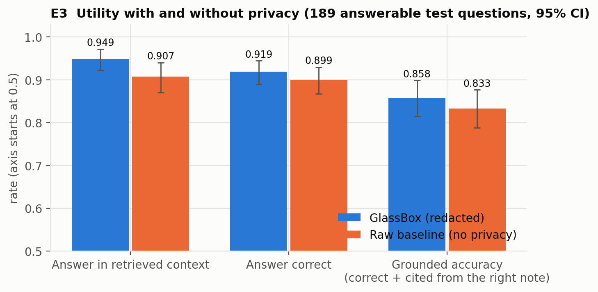
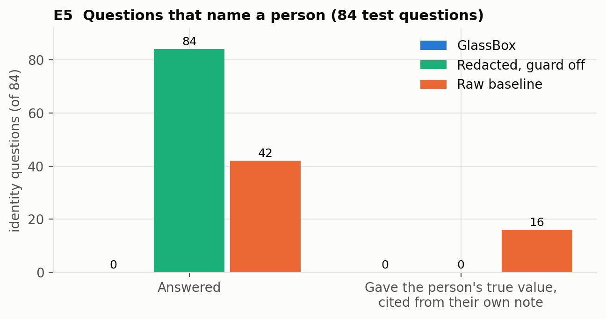
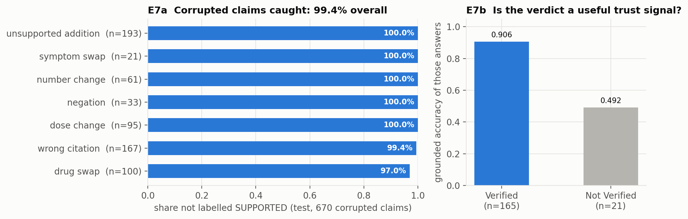

# GlassBox

**A Privacy-Preserving and Verifiably Explainable Framework for LLM Systems**

---

## 1. What This Project Is About

Large Language Models are increasingly used to analyze sensitive documents — medical notes, financial records, HR files, confidential business data. Two problems come up every time this happens:

1. **Privacy risk.** Most LLM pipelines hand over far more data than a given query actually needs. A conventional RAG system might retrieve several full documents and pass them straight into the model's context, exposing names, IDs, and other identifying information the query never asked about.
2. **No way to verify the answer.** Even when an LLM produces a fluent, confident response, there's typically no way for the user to check what evidence (if any) actually supports each claim. LLMs hallucinate, and nothing in a standard pipeline catches this automatically.

These two problems compound each other: the more a system protects privacy by withholding data, the less visibility the user has into what the model actually saw — which gives the user *more* reason to distrust the output, not less. A system that's privacy-preserving but opaque asks for blind trust at exactly the moment trust is hardest to justify.

**GlassBox treats privacy-preservation and verifiable explainability as one integrated problem, not two separate features bolted together.** The core idea: the user shouldn't have to trust the LLM's honesty — they should only have to trust a process they can fully inspect. Every stage between the raw data and the final answer is logged and auditable, so a user (or evaluator) can see exactly what was redacted, what was retrieved, what was claimed, and whether each claim actually holds up against its cited evidence.

---

## 2. Solution and Approach

GlassBox is built as a pipeline with four cooperating stages, sitting between the private dataset and the final answer:

1. **Privacy-aware data processing** — before anything reaches the LLM, sensitive fields (names, patient IDs, phone numbers, addresses, etc.) are automatically detected and redacted or pseudonymized. The LLM never sees more identifying information than necessary.
2. **Access-controlled, logged retrieval** — instead of dumping an entire dataset into context, a retrieval layer selects only the relevant, sanitized slice of data for a given query, and logs exactly what was retrieved and why.
3. **Evidence-based generation** — the LLM is required to tie every factual claim in its answer to a specific retrieved fragment via citation, rather than producing free-floating assertions.
4. **Independent claim verification** — a separate verification mechanism (not the LLM grading itself) checks whether each cited fragment actually supports its claim, classifying it as **Supported**, **Unsupported**, **Contradicted**, or **Uncertain**. This is the project's core novel contribution — a concrete, automatable measure of hallucination rather than something the user has to catch by eye.

Every stage's output is surfaced through an **audit dashboard**, so the full trail — what was redacted, what was retrieved, what was generated, what was verified — is inspectable end to end.

### Scoping decisions

Given a 3-month, solo-built timeline, a few deliberate cuts were made to keep the project buildable without weakening its core argument:

- **Differential privacy, federated learning, and homomorphic encryption are explicitly out of scope** for this implementation. Redaction/pseudonymization is deterministic (entity detection + masking), not formally private. These are named as future work rather than attempted half-way.
- **Domain is locked to synthetic healthcare records.** Real clinical data (e.g. MIMIC) would require data-use approvals that risk eating weeks of a tight timeline for uncertain payoff. Synthetic data also gives exact ground-truth PII locations, which makes redaction evaluation more rigorous, not less.
- **A locally-hosted, open-weight LLM is used throughout** (rather than a third-party API), so the privacy guarantee extends to the model-serving step itself, not just the preprocessing step.

### Why this matters

The contribution here isn't a new PII detector, a new RAG technique, or a new explainability method in isolation — all three already exist in the literature separately. The contribution is a **working, evaluated integration** of privacy-minimization and verifiable evidence-tracing into a single pipeline, plus an empirical look at the tradeoff between privacy protection, answer utility, and explanation faithfulness — rather than assuming improving one doesn't cost the others.

---

## 3. System Architecture

```
question ──► question redaction ──► query analysis ──► hybrid retrieval ──► abstain guard ──► cited generation ──► claim verification ──► answer + audit trace
            (Presidio + rules)     (diagnosis/date     (redacted index:     (refuse if the     (Qwen2.5-7B, local,   (DeBERTa-v3-large
                                    filters, scope)     dense + BM25)        question names     JSON claims with      NLI, one label
                                                                             a person)          citations)            per claim)
```

The notes are redacted once, before indexing; the model only ever sees redacted text. Each question produces one JSON **audit trace** (`glassbox/logs/traces/`) that records every stage: what was removed from the question, the filters, every retrieved chunk with its scores, the model's raw output, the claims and their citations, and each claim's verification label. A redacted-configuration trace never contains the original question.

| Stage | What it does | Code |
|---|---|---|
| Redaction | Presidio + spaCy with custom recognizers (patient IDs, DOB year range, phones, US addresses, names next to credentials and labels) and a clinical-term guard so drug names and vitals survive | `glassbox/src/redaction/` |
| Retrieval | Section chunks; exact dense search (bge-small) + in-house BM25, fused 2:1; diagnosis/date filters from the question; two-hop selection for "which patients … " questions; the raw index needs explicit baseline access | `glassbox/src/retrieval/` |
| Generation | Qwen2.5-7B-Instruct 4-bit via MLX, greedy (reproducible); answers as JSON claims citing sources; refuses *before* the model runs if the question identifies a person or matches no note | `glassbox/src/generation/` |
| Verification | An independent NLI model checks each claim against the chunk(s) it cites: SUPPORTED / CONTRADICTED / UNSUPPORTED / UNCERTAIN | `glassbox/src/verification/` |
| Pipeline + dashboard | `GlassBox(...).answer(q)` chains the stages with no logic of its own; Streamlit dashboard with a live demo, the trace audit view and the experiment figures | `glassbox/src/pipeline.py`, `glassbox/src/dashboard/` |

**Data:** 2,500 synthetic clinical notes in four EHR styles (SOAP, progress, discharge, consultation) with exact ground-truth PII spans, plus a 250-note second dataset from a different generator. 390 evaluation questions (clinical fact, multi-patient aggregate, and identity questions that must *not* be answerable), split 30% dev / 70% test. All data is synthetic; no real patients.

---

## 4. Results

Realistic dataset, **test split** (choices were tuned on dev only), bootstrap 95% confidence intervals. Figures: `glassbox/results/figures/`; every number below is in `glassbox/results/figures/summary.json`.

| | GlassBox | No-privacy baseline |
|---|---|---|
| PII detection F1 / values left visible in the index | **0.999** / **0.04%** partly, 0.01% fully | n/a / 100% |
| Answer is in the retrieved context (189 answerable questions) | **0.949** [0.922, 0.972] | 0.907 |
| **Grounded accuracy** (answer correct *and* cited from the right patient's note) | **0.858** [0.815, 0.899] | 0.833 [0.788, 0.877] |
| Questions naming a person (84): answered / gave the person's true value | **0 / 0** | 42 / 16 |
| Corrupted claims caught by the verifier (670) | **99.4%**; 1.2% of clean genuine claims wrongly flagged | |
| Grounded accuracy of answers marked VERIFIED vs NOT_VERIFIED | **0.906** vs 0.492 | |
| PII values found in 9,630 log and trace records | **0** | (positive control: 7,952) |
| Time per question (Apple-silicon laptop) | 3.2 s, ~98% of it the 7B model | 3.1 s |





**Limitations, measured rather than assumed:**
- **Template wording.** On reworded questions held out before any fix, retrieval evidence drops from 0.949 to 0.579 and grounded accuracy from 0.858 to 0.502 (`E8_robustness.png`).
- **Unseen note formats.** On a held-out set of new note layouts, 0.819 of PII values are fully masked (0.999 in-distribution). PO boxes and multi-line addresses are missed, and names of Turkish (0.57), Vietnamese (0.70) and Spanish (0.73) origin are masked less often than English ones (0.97) (`E1c_name_origin_bias.png`).
- **Verification checks evidence, not identity.** With the guard off, the verifier marks most claims about the wrong patient SUPPORTED. The guard is what protects identities.
- **Redaction, not formal privacy.** No differential privacy; synthetic data only.

Full design decisions, alternatives, numbers and problems found: [`PROGRESS.md`](PROGRESS.md). Build plan: [`PLAN.md`](PLAN.md). Demo script: [`DEMO.md`](DEMO.md).

---

## 5. Quick start

Requires an Apple-silicon Mac (MLX) and Python 3.11.

```bash
python3.11 -m venv .venv && source .venv/bin/activate
pip install -r requirements.txt && python -m spacy download en_core_web_lg

# Data, redaction, indexes (deterministic; a few minutes)
python -m glassbox.src.generate_realistic_dataset --size large
python -m glassbox.src.redaction.pipeline --dataset realistic
python -m glassbox.src.retrieval.index --dataset realistic --all

# Ask a question (the 7B model downloads on first use)
python -m glassbox.run "What medication was prescribed for the Essential hypertension patient whose note is dated 2024-11-10?"

# Dashboard: live demo, trace audit, experiment figures (http://localhost:8501, local only)
streamlit run glassbox/src/dashboard/app.py

# Check the stored results against the code, live (~1 minute)
python -m glassbox.verify
```

**Reproducing the evaluation** (all outputs land in `glassbox/results/`):

```bash
python -m glassbox.src.retrieval.evaluate --dataset realistic
python -m glassbox.src.generation.evaluate --dataset realistic          # ~1 h, 3 configurations
python -m glassbox.src.verification.corruptions && python -m glassbox.src.verification.evaluate
python -m glassbox.src.experiments.threshold_sweep                      # ~2 h
python -m glassbox.run --qa-set [--config raw|redacted_noguard]         # end-to-end traces
python -m glassbox.src.experiments.log_pii_scan
python -m glassbox.src.experiments.figures                              # figures + summary.json
python -m pytest glassbox/tests                                         # ~30 s
```

---

## Tech Stack

- **Language:** Python 3.11
- **PII detection:** Presidio, spaCy (`en_core_web_lg`)
- **Retrieval:** sentence-transformers (`BAAI/bge-small-en-v1.5`), ChromaDB (storage), NumPy exact search, in-house BM25
- **Local LLM:** MLX, Qwen2.5-7B-Instruct (4-bit)
- **Verification:** `MoritzLaurer/DeBERTa-v3-large-mnli-fever-anli-ling-wanli`
- **Dashboard and figures:** Streamlit, matplotlib
- **Synthetic data:** Faker
